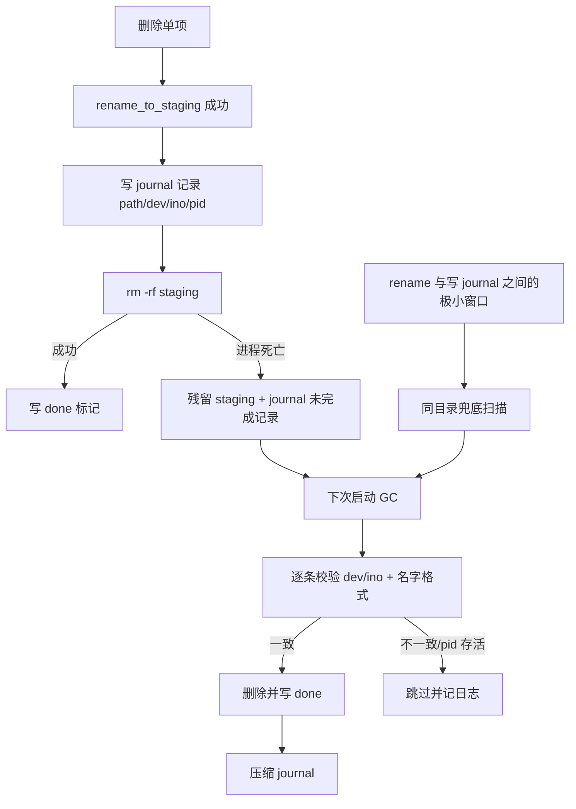

# 清理中断残留的启动收尾（GC）方案

> 目标：删除过程中 App 被杀 / 崩溃 / 断电后，不留「看不见但占空间」的残留；
> 下次启动自动收尾，结果如实落到日志页，不主动打扰用户。
> 状态：**已实现 · 测试通过 · 已提交并推送两仓 main，未发版**（2026-11-12 同步；实现现状见 §0）

## 0. 实现现状（2026-11-12 补记）

> §1–§7 保留方案原始论证。凡「原文设计」与「最终落地」不一致处，以本节结论和正文里的
> **实现注**为准 —— 这些偏差都有实测原因，不是漏做。

| 阶段 | 状态 | 落地与实证 |
| ---- | ---- | ---------- |
| P0 | ✅ | `core/staging_journal.rs`（journal + flock + 20k 截断）、`core/gc.rs`（启动 replay / 状态 / 预算）、`ops` 三处埋点；core 单测全绿 |
| P1 | ✅ | `ops::sweep_stale_staging` + 60s 父目录缓存；「rename 成功但无 journal 线索」的窗口有专门崩溃注入用例，证明靠 Layer 2 兜住 |
| P2 | ✅ | pro 侧 `gc_status` / `cleanup-recovered` / setup 后台 spawn / 概览「收尾中…」全部接线；事件进 `EVENT_CONTRACT` 并纳入 `check:contract`；**收尾全程静默，不弹 toast**（见 §3 决策变更） |
| P3 | ✅ | 崩溃注入 4 轮（rename / stage-abort / stage-kill9 / rm）、跨进程并发、真机 SIGKILL + `df` 校验、macOS/Linux/Windows 三平台验证、Windows 原生 runner 实跑 |

补充完成、但原方案未列的：

* **CLI 同步收尾**：`gc::recover_if_needed()` 接在 `run_cli_with_version()` 命令入口。短生命周期进程不能照搬 App 的后台 spawn（线程可能没跑完进程就退出了）；journal 为空时只做一次小文件读 + `.pending.json` 对账，零写。
* **journal 自身的写-压缩互斥**：独立 `staging.journal.lock` + `flock`（Windows 降级为进程内 `WRITER` + `O_APPEND`），压缩改为原地截断重写而非 `tmp + rename`。
* **批结束归零**：`compact_finished()` 接在 `start_delete` 批结束，方案 §6.4「正常一轮清理后 journal 0 行」才真正成立。
* **预算可注入**：debug 构建读 `MACLEAN_TEST_GC_BUDGET_MS`，`0` 作耗尽哨兵，release 恒 30s；不用空跑 30 秒就能验证超时分支。
* **Windows `pid_alive`**：原实现在非 unix 分支恒返回 `false`，等于「造 staging 的进程还活着就别动」这道闸在 Windows 完全失效（双开会误删）。已用 kernel32 `OpenProcess(PROCESS_QUERY_LIMITED_INFORMATION)` + `CloseHandle` 补上，未引入新 crate。

**提交与发布状态（2026-11-12 09:47 核对）**：

* 公开仓 `maclean`：`e8dcab1 feat(core)` + `8f90791 test(gc)` 已提交并推送 `origin/main` / `gitee/main`，`gc` / `staging_journal` 模块、CLI 同步收尾与全部测试资产都在 HEAD 上。工作区仍有 3 个代码文件未暂存：`windows-ci.yml`（加 `--no-fail-fast`）、`gc.rs` / `ops/mod.rs`（Linux cfg 分支的断言收紧）。
* pro 仓：`bca52cf feat(ui)` + `a21751a test(ui)` 已提交并推送 main。
* **依赖形态（12:05 已修，CI 转绿）**：pro 仓 `Cargo.toml` 一度用本地 `path = "../../../maclean/crates/maclean-core"`，CI runner 上没有同级 `maclean/` 目录 → `cargo metadata` 失败（run `43136050719` 实证，两条 run 全红）。已改为 `git = "https://github.com/jamesfeng2009/maclean.git", branch = "main"`（`Cargo.lock` 锁 commit），提交 `fix(ci)` 后 run `43138934885` 绿。
* **发版顺序**：crates.io 的 `0.4.4` 不含 `gc` / `staging_journal`。正式发版前必须**先发布 core `0.4.5`，再把 pro 改回 `version = "=0.4.5"`**；反过来必然 unresolved。

**已知限制（不冒充已解决）**：

* Windows 拿不到跨重启稳定的 `(dev, ino)`：journal 记 `0/0`，防误删降级为「名字严格格式 + pid 已退出」；`volume_available` 返回 `None`，`bytes` 恒 0（日志页汇总里显示 0 B）。
* 真机 `mdfind` **不做硬断言**：Spotlight 默认不索引 `.maclean_stage_*` 且索引异步，「查不到」是恒真；硬断言用 `read_dir` + `symlink_metadata` + `df -k`。
* root 拥有项（需免密 sudo）与 TCC 目录（需给终端完全磁盘访问权限）依赖运行环境，验证脚本标 SKIP；它们与 immutable 走同一条 `remove_staging_tree` 失败分支，代码路径已覆盖。

## 1. 现场事实（代码已核对）


| 事实                                                     | 位置                                               | 含义                                                   |
| ------------------------------------------------------ | ------------------------------------------------ | ---------------------------------------------------- |
| staging 名 = `.maclean_stage_{pid}_{nanos:x}_{attempt}` | `core/ops/mod.rs:217 rename_to_staging`          | 残留是**散落在被删项的原父目录**里的隐藏目录，不在某个统一 staging 根            |
| 改名用 `renameatx_np(RENAME_EXCL)`                        | 同上                                               | 原子、绝不覆盖外部文件；同目录同卷，所以「统一 staging 根」方案不可行（卷根一般不可写）     |
| staging 只在本进程内知道                                       | `best_effort_delete_with_reason`                 | 进程一死，**没有任何持久记录**指向它 → 这是 GC 的关键缺口                   |
| `.pending.json` = 删前快照                                 | `core/backup.rs:196 record_pending`              | 崩溃后留存是**设计预期**（审计用），不占空间；正常结束由 `finalize_pending` 清除 |
| 废纸篓 `claim_trash_name` 只做名字查重                          | `core/backup.rs claim_trash_name`                | 不落标记文件，无残留；崩溃最多是 Trash 里多一个没清单的文件                    |
| 现场实测                                                   | `mdfind .maclean_stage_*` / `~/.maclean/backups` | 当前 0 个 staging 残留、0 个 pending，属于 "没触发过"，不是 "不会发生"    |

结论：需要收尾的**只有 staging 残留**（真实占空间 + 用户可见的怪目录）；

`.pending.json` 只需在对账时标记为 "上次清理中断"，不需要删。

## 2. 整体思路：日志（权威）+ 扫描（兜底）双层




### 2.1 Layer 1：staging journal（权威记录）


* 文件：`~/.maclean/staging.journal`，JSONL，逐行一条：


  * 开始：`{"v":1,"ts":1699999999,"pid":1234,"path":"/Users/x/Library/Caches/.maclean_stage_1234_1a2b_0","dev":16777220,"ino":123456}`

  * 完成：`{"v":1,"ts":...,"done":"<同一 path>"}`

* 写入时机：`rename_to_staging` **返回成功后立刻写**（在 `best_effort_delete_with_reason` 里，拿到 staging 路径后、执行 rm 之前）。

* 写入成本控制：行缓冲 + 每 200 条或每批结束 `fsync` 一次；不为每个 inode 付一次 fsync（一次 70 项 / 136 路径的清理里，单项删除可能上万次，逐条 fsync 会明显拖慢）。

  **实现注**：批结束除 `flush()` 外还调 `compact_finished()`，把已 done 的行压掉，正常一轮清理后 journal 归 0 行（方案 §6.4）；`reconcile_open()` 在总量超过 `MAX_JOURNAL_LINES = 20_000` 行时强制截断、只保留未完成项（方案 §4）。

* 已知窗口：rename 成功 → journal 落盘之间若断电，这条不会被记录；由 Layer 2 兜底。

* 并发：App 内用一把 `Mutex<File>` 串行写；跨进程（极少，双开）由 GC 的 pid 存活检查兜底。

  **实现注**：这条原设计不够 —— CLI 与 App 共用同一个 journal，双进程各持一把进程内锁、互不知情；压缩若用 `tmp + rename` 换 inode，另一进程缓存的 fd 会继续写已 unlink 的孤儿文件（整批丢）。最终加了固定路径的 `staging.journal.lock` + `flock` 串行化 append/compact，并把压缩改成**原地截断重写**保住 inode；JSONL 逐行容错，最坏只丢一行而非整批。锁顺序固定为 `flock → WRITER`，不会死锁。Windows 无 flock，降级为进程内锁 + `O_APPEND`。

### 2.2 Layer 2：同目录兜底扫描（覆盖窗口 + 历史残留）

在批量 / 单项删除开始前，对**本次要操作的父目录**做一次 `read_dir`（本来也要枚举，边际成本近似 0）：


* 只匹配严格格式 `^\.maclean_stage_(\d+)_([0-9a-f]+)_(\d+)$`；

* 条件：`pid != 当前进程` 且 pid 不存活（`kill(pid,0)` ESRCH） 且 `mtime` 早于 60s（避免和另一个实例正在进行的删除抢）；

* 命中即 `rm -rf`（复用现成的 chflags/chmod 重试逻辑）。

* **不做全盘扫描**：代价不可接受，且没有任何必要 —— 残留只可能出现在用户清理过的目录里。

### 2.3 启动 GC（`gc::run_startup_cleanup`）

在 `lib.rs setup()` 里 `std::thread::spawn`，流程：


1. 读 journal，构建 `path → 最后状态`；只留未 `done` 的记录；

2. 逐条：

* `symlink_metadata`（**不跟随符号链接**）；

* 校验 basename 符合 staging 格式、`(dev, ino)` 与记录一致 → 不一致说明名字被复用 / 对象被换过，**跳过并记 warn**；

* pid 仍存活 → 跳过（下次再收）；

* 删除：`rm -rf` → 失败则 chflags/chmod 重试 → 仍失败记日志并保留记录；

* 成功则追加 `done`；

3. 统计：`statvfs` 前后差值 = 真实回收字节；耗时、条数、失败数；

4. 压缩 journal（只保留未完成项）；

   **实现注**：最终是 `compact()` 无参、压缩时**重读 `unfinished()`**（不再用循环开始时的旧快照，否则 GC 后台跑时用户发起清理、期间 append 的新 start 记录会被抹掉），并且**原地截断重写**而非 `tmp + rename`。原因见 §2.1 实现注。

5. `.pending.json` 对账：仅重命名为 `<id>.interrupted.json`（或只记日志），**不删**，避免丢审计证据；

6. 全程不阻塞 UI；总预算 30s，超时就让线程继续跑完（状态里显示 "收尾中"）。

   **实现注**：`budget_for_this_run()` 在 debug 构建读 `MACLEAN_TEST_GC_BUDGET_MS`（`0` = 已耗尽），release 恒 `GC_TOTAL_BUDGET = 30s`；超预算的记录原样留在 journal 供下次启动续跑。App 用 `spawn_startup_cleanup`，**CLI 用同步的 `recover_if_needed()`**（见 §0）。Windows 侧 `(dev, ino)` 与 `bytes` 的降级见 §0。

失败一律「记录 + 下次重试」，不允许 panic，不允许因为收尾失败影响启动。

### 2.4 为什么不用 "统一 staging 根"

`<卷根>/.maclean_staging/` 看似更好收尾，但：卷根（`/`、`/System/Volumes/Data`）普通用户不可写，

且跨目录 rename 仍需同卷权限；为它申请提权得不偿失。保持 "同父目录 staging + journal" 是本方案的地基。

## 3. 前端（pro）配合


| 位置     | 行为                                               |
| ------ | ------------------------------------------------ |
| 启动     | GC 在后台跑，不弹窗、不遮罩                                  |
| 真回收到空间 | **完全静默**：不弹 toast，只收掉「收尾中…」并重拉一次概览磁盘数字；明细写日志页 |
| 收尾仍在跑  | 概览磁盘卡副标题追加「收尾中…」（与「清理中」同一处样式）                    |
| 收尾失败   | 同样静默，只在日志页可见（含 `failed` 计数），不打扰用户                 |

新增 IPC：`gc_status() -> GcStatus { running, cleaned, failed, bytes, took_ms }`；

事件：`cleanup-recovered`（payload 同 GcStatus）。两者都进 `COMMAND_CONTRACT` 与 `check:contract`。

**实现注**：事件原先只进了 Rust 侧常量、没进契约脚本，现已补上 `EVENT_CONTRACT`（8 个事件，emit ↔ 契约 ↔ 前端 listen 三方对账）。原方案的「`cleaned>0` 弹一次 toast」在 2026-11-12 被**整体废弃**，最终口径是完全静默，理由见下方决策变更。

**2026-11-12 决策变更（收尾提示彻底移除）**：演进过两版 —— 先因「组件实例级闸门 + Rust 静态 `STATUS`」导致重挂载 / 刷新反复弹同一轮结果，改成模块级单例 + `sessionStorage` 指纹去重；随后复核发现方向本身错了：通用清理工具（macOS 储存空间管理、CleanMyMac、CCleaner 等）对**隐式后台回收**从不主动告知，用户压根没发起过这次动作，弹「上次清理未完成，已收尾释放 X」会凭空制造因果，让人误以为刚清了东西或上次清理失败。CCleaner v6.27 甚至专门把清理通知减到「只显示最近一条」并允许永久关闭 —— 那还是用户**亲手点过清理**的结果回执。

最终落地：`gcToast.mjs` / `.d.mts` 与 13 个去重用例**一并删除**；`cleanup-recovered` 事件、`gc_status()` 快照、Rust emit 和跨仓契约**全部保留**。收口逻辑抽成零依赖纯模块 `gcStatus.mjs` 的 `createGcStatusSink()`，事件与快照两条路径共用一个 sink，只做状态复位（收掉「收尾中…」+ 用 `refreshed` 挡住重复重拉磁盘数字），不产生任何用户可见提示。抽纯函数不是为了复用，是为了让测试**调用生产逻辑**：源码级断言只能证明「没写 toast 这几个字」，注入 toast spy 才能在运行时证明零提示。静默的兜底是日志页：`[gc] 收尾完成` 汇总带 `failed` 计数、`[gc] 收尾失败` 带明细，真机脚本已断言可见 —— 权限失败项因此仍可追溯，只是不主动推给用户。`test-gc-toast.mjs` 共 **20 个用例**（9 条源码级接线 + 11 条运行时行为，覆盖 running / cleaned=0 / failed>0 / 事件-快照三种时序 / 重挂载 / 空 payload），三组反向 mutation 实证：把 toast 接回生产模块 → 11 红，破坏 `refreshed` 去重 → 3 红，拆掉快照接线 → 2 红；恢复后 20/20 绿、无探针残留。

## 4. 失败与边界清单


| 场景                     | 处理                                   |
| ---------------------- | ------------------------------------ |
| staging 名对、dev/ino 不符  | 跳过，warn 日志（防误删用户同名文件）                |
| 同 pid 进程仍活（另一实例在删）     | 跳过，60s 后由 Layer 2 / 下次启动再收           |
| 权限不足（TCC 目录、root 拥有的项） | 记日志保留记录；下次启动重试；不弹窗                   |
| 磁盘拔掉 / 外置卷不在           | 路径不存在 → 标 done（卷上的东西已不可达）            |
| journal 损坏（半行）         | 逐行容错解析，坏行丢弃并重写                       |
| journal 巨大             | 启动压缩；超过 20k 行强制截断（保留未完成项）            |
| 收尾期间用户又发起清理            | 两把锁分离（GC 独立于 `CLEAN_IN_FLIGHT`），互不阻塞 |

**实现注**：「两把锁分离」只解决了 GC 与清理互不阻塞，没解决 **journal 自身的写-压缩互斥** —— 压缩用旧快照会抹掉并发 append 的新记录。现补第三层：固定 `.lock` 文件 + `flock` 串行化 append/compact，压缩时重读 `unfinished()`。详见 §2.1 / §2.3 实现注。

另：外置卷「拔出 → 标 done → 再插回」时 journal 已无线索，只能靠 Layer 2 在用户下次清理同父目录时兜住，残留不会永久遗留但也不会立刻消失；这是方案的既定取舍，不是回归。

## 5. 分阶段实施


| 阶段 | 内容                          | 影响面                                             | 验收                                         | 状态 |
| -- | --------------------------- | ----------------------------------------------- | ------------------------------------------ | ---- |
| P0 | journal 写入 + 启动 replay + 单测 | core 新增 `staging_journal.rs`、`gc.rs`；`ops` 两处埋点 | 单测：正常删除后 journal 空；伪造未完成记录能被清；dev/ino 不符不删 | ✅ 已完成 |
| P1 | 删除前同目录兜底扫描                  | core `ops`（删路径入口）                               | 模拟残留目录，删除同父目录其它项时被顺带清掉                     | ✅ 已完成 |
| P2 | IPC + 前端状态收口              | pro `commands.rs` / `lib.rs` / store / Overview | 契约检查通过；收尾全程静默，结果在日志页可追溯               | ✅ 已完成 |
| P3 | 崩溃注入 + 真机验证                 | 测试脚本                                            | `kill -9` 后重启，残留清零、磁盘可用量上升、日志页收尾记录正确   | ✅ 已完成（真机 2 项 SKIP） |

原预估 core ~350 行（含单测）、pro ~80 行；**实际远超预估** —— 并发互斥、跨平台 `pid_alive`、可注入预算、8 维测试场景、真机脚本与 Windows 原生 runner 验证都是方案阶段没算进去的。

## 6. 验证方法（可复现）

1. **单测 / 门禁**（公开仓）：

   ```bash
   cargo test --workspace
   cargo fmt --all -- --check
   cargo clippy --workspace --all-targets -- -D warnings
   ```

   覆盖伪造记录能被清、dev/ino 不符不删、名字严格格式、symlink 不跟随、半行容错、
   >20k 行截断、`compact` 旧快照回归、批结束归零、`chflags uchg` / 父目录 0555 权限失败、
   预算耗尽保留记录等。新增断言均做过**反向 mutation 验证**（把实现改坏 → 测试必须变红 → 恢复 → 绿）。

2. **崩溃注入**：`crates/maclean-core/tests/crash_recovery.rs` 用子进程参数化 4 轮：
   `MACLEAN_TEST_CRASH_AT=rename|stage|rm` + `MACLEAN_TEST_KILL_AT=stage`（真 SIGKILL）。
   `rename` 轮先断言 GC 单独收不掉、再断言 Layer 2 兜底清干净 —— 这是双层设计里最关键的窗口，
   原方案只测了 `stage` 一刀。

   ```bash
   cargo test -p maclean-core --test crash_recovery -- --nocapture
   cargo test -p maclean-core --test journal_concurrency -- --nocapture  # 两真进程 flock 并发 append
   ```

3. **真机**（macOS，需 ~128MB 临时空间）：

   ```bash
   ./scripts/verify-gc-real-machine.sh
   ```

   真 SIGKILL → `crates/maclean-core/tests/real_machine_gc.rs`（默认 `#[ignore]`）→
   断言 `read_dir` 残留清零、`df -k` 可用量上升、`~/.maclean/logs` 含收尾记录。
   实测汇总 PASS=7 / FAIL=0 / SKIP=2；SKIP 的两项是 root 拥有项与 TCC 目录（见 §0）。
   **`mdfind` 只打印观察值、不做断言**（理由见 §0）。

4. **跨平台**：`./scripts/verify-windows-runner.sh` 推临时分支触发 `windows-ci.yml` 原生 runner，
   跑 `cargo test --workspace --no-fail-fast`。`--no-fail-fast` 是实跑中补的：首个测试目标失败时
   cargo 会直接中止，core 的几百个用例根本没跑到。macOS 上交叉
   `cargo check -p maclean-core --all-targets --target ...` 只证明能编译，**不替代运行时实跑** ——
   Windows 原生 runner 第一轮就抓出 `pid_alive` 恒 false 这个本机永远发现不了的生产缺陷。

5. **前端 / 契约**（pro 仓）：

   ```bash
   npm run check:contract   # 46 命令 + 8 事件，emit ↔ 契约 ↔ listen 三方对账
   npm run test:gc-toast    # 20 个用例：9 静态接线 + 11 运行时零提示（注入 toast spy）
   npx tsc --noEmit
   ```

6. **回归**：正常清理一轮后 journal 为 0 行（`compact_finished()`），delete.log 无新增 warn。

## 7. 明确不做


* 不做全盘递归扫描找 staging（代价不可接受）；

* 不删 `.pending.json`（审计证据），只标记；

* 不做「关掉 App 也继续删」的常驻进程（进程内线程语义不变）；

* 不承诺 "一定能收尾"—— 权限 / 外置卷场景可能保留到下次。
